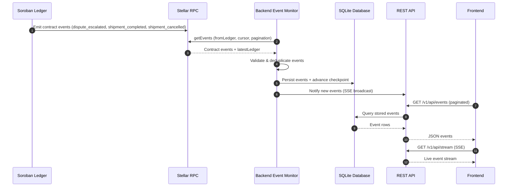

# StellarSettle Backend

Node.js API and Soroban RPC event monitor for shipment escalation alerts, lifecycle events (`shipment_completed`, `shipment_cancelled`), and off-chain shipment metadata.

## Architecture: event pipeline

The backend event monitor pipeline flows from the Soroban ledger through the RPC event subscription, into the backend handler, persisted to the database, exposed via the REST API, and consumed by the frontend.



## Requirements

- Node.js **≥ 22.5**
- A deployed StellarSettle contract (optional — the server starts without one and
  the event monitor is simply disabled)

## Setup

```sh
cp .env.example .env
# Edit .env — at minimum set STELLAR_CONTRACT_ID
npm install
npm run dev        # ts-node watch mode
```

Set `STELLAR_CONTRACT_ID` to enable the event monitor. By default, it scans recent contract events on Testnet and persists `dispute_escalated`, `shipment_completed`, and `shipment_cancelled` events as well as metadata in a local SQLite database. The API exposes `GET /api/health`, `GET /metrics` (Prometheus format: request counts, latency histograms, event-poll success/failure), `GET /api/events`, `GET /api/stream` (SSE), shipment endpoints, and metadata read/write endpoints. Metadata writes are disabled until a non-empty `METADATA_API_KEY` is configured; keep that key on the server and never expose it in frontend variables.

The event monitor resumes from a SQLite checkpoint on restart and automatically backfills missed, retained ledgers. This service does not sign or submit contract transactions; the connected wallet remains responsible for user-authorized actions.

## Lending (loan_manager) read API

Read-only endpoints backed by the `contracts/loan_manager` indexer and Soroban RPC reads. They follow the same validation and pagination conventions as the escrow endpoints (`limit`/`cursor` query params, `400` on invalid input).

- `GET /api/lending/pool` — current pool state (total deposits, outstanding principal, utilization) read from on-chain `loan_manager` state.
- `GET /api/lending/positions/:address` — a borrower's position for the given Stellar address; `400` if the address is malformed.
- `GET /api/lending/liquidations` — paginated liquidation history from the indexer, using `limit` and `cursor` like `GET /api/events`.

```sh
npm run typecheck
npm test
npm run build
npm start
```

## Startup backfill and recovery

Keep `DATABASE_PATH` on persistent storage. Checkpoints are scoped to the configured network and contract and advance only after a complete ledger chunk has been processed, including chunks with no matching events. Interrupted chunks are replayed on restart; existing event IDs are deduplicated before SSE delivery.

The first ledger to scan is selected in this order:

1. `BACKFILL_FROM_LEDGER`: an **inclusive** recovery override (positive ledger number).
2. `START_LEDGER`: the legacy **exclusive** override (the first request starts at this value plus one).
3. The saved checkpoint plus one.
4. On a fresh database, the latest ten ledgers. An existing database from before checkpoint support also uses this fallback; set a recovery override if older history is required.

Blank environment values count as unset. Remove explicit ledger overrides after recovery so subsequent restarts use the saved checkpoint.

Each pass makes at most `BACKFILL_MAX_PAGES` event requests (default `10`, allowed `1`–`100`), plus one retention-health request. Requests cover chunks of at most 1,000 ledgers and pages of 100 events. Startup runs one bounded pass before listening; remaining work continues every `POLL_INTERVAL_MS`, without overlapping polls. This limits requests per pass, not wall-clock duration. Failed requests retain the last completed checkpoint for retry. Cursor pagination carries across passes; RPC `endLedger` is exclusive, so the latest ledger is included using `latestLedger + 1`.

Retention is obtained from the RPC's [`getHealth` ledger window](https://developers.stellar.org/docs/data/apis/rpc/api-reference/methods/getHealth), rather than assuming a fixed number of days. If the next required ledger is older than `oldestLedger`, the monitor logs an explicit warning with `fromLedger` and `toLedger`, records the unavailable interval, and resumes at the oldest retained ledger. Those missing events **cannot be recovered from that RPC**. Invalid retention information fails the poll rather than silently skipping history.

`GET /api/health` includes `lastScannedLedger` and `backfill` with `status` (`pending`, `running`, or `complete`), the startup `targetLedger`, and `retentionGap` (`null` or `{ fromLedger, toLedger }`). Completion means the retained startup range has been scanned; it does not mean expired history was recovered. The most recently detected gap remains recorded across catch-up and restarts; logs preserve earlier gap intervals. `backfill` is `null` when no contract is configured.

To recover a reported gap, use an RPC provider that still retains the required range and set `BACKFILL_FROM_LEDGER` to its first missing ledger, then restart. Checkpoint scope deliberately excludes the RPC URL so changing providers preserves progress. Remove the override after recovery. The historical gap warning remains available for operator audit even after an explicit replay; inspect recovery logs and stored events to verify that replay. If no provider retains the range, an external archival source is required; this service does not fabricate or silently mark that history as recovered.

## Database migrations

The backend runs all pending schema migrations automatically at startup. Schema changes live in `migrations/` as `NNN_name.up.sql` / `NNN_name.down.sql` pairs. Applied migrations are tracked in the `schema_migrations` table of the database at `DATABASE_PATH`; the initial migration also adopts existing tables without deleting their data.

```sh
npm run db:migrate    # apply all pending migrations
npm run db:rollback   # revert the most recently applied migration
```

To add a migration, create the next-numbered `.up.sql` and matching `.down.sql` file in `migrations/`. Put the forward schema change in `.up.sql` and its rollback in `.down.sql`; the next application startup will apply it. Run `npm run db:migrate` to apply pending migrations manually or `npm run db:rollback` to roll back the latest one.

## API Endpoints

All API routes are versioned under `/v1` (e.g. `GET /v1/api/health`). Contract state reads are cached in memory for `CONTRACT_CACHE_TTL_MS` (default `5000`).

## Environment variables

- **`WEB_ORIGIN`** — A single browser origin or a comma-separated list of origins allowed by CORS (default: `http://localhost:5173`).

- **GET /v1/api/health** — Check service status, network, and event monitor state
- **GET /v1/api/events** — Retrieve paginated `dispute_escalated`, `shipment_completed`, and `shipment_cancelled` events (query params: `after` ledger, `limit` max 100, optional `type` and `shipmentId`)
- **GET /v1/api/stream** — Server-Sent Events stream of contract events (SSE)

### Stats

- **GET /v1/api/stats** — Contract-wide aggregate metrics for dashboard/landing widgets (#56)
  - Returns: `{ totalShipments, totalVolume, totalDisputes, completedShipments, totalEscrowed?, fetchedAt }`
  - `totalVolume` is returned as a string to preserve i128 precision (stroops)
  - `totalEscrowed` is included only when `STELLAR_STATS_TOKEN` env var is set to a token SAC address
  - Results are cached in-memory for 30 seconds (`x-cache` header: `hit` / `miss` / `stale`)
  - Returns 503 if `STELLAR_CONTRACT_ID` is not configured or the contract call fails
  - Description: Aggregates on-chain figures from the contract's `get_contract_stats` and `get_total_escrowed_value` read functions

### Shipments

All shipment routes proxy Soroban RPC calls to the deployed contract. They
return `503 { "error": "contract_not_configured" }` when `STELLAR_CONTRACT_ID`
is not set.

| Method | Path | Auth | Description |
|---|---|---|---|
| `GET` | `/api/shipments` | None | List shipment IDs with cursor-based pagination. Proxies the contract's `list_shipments` function. |
| `GET` | `/api/shipments/:id` | None | Retrieve the full `Shipment` struct for a single shipment by its ID. Retu

/* … truncated 4479 chars — edit only what you need near the top … */
